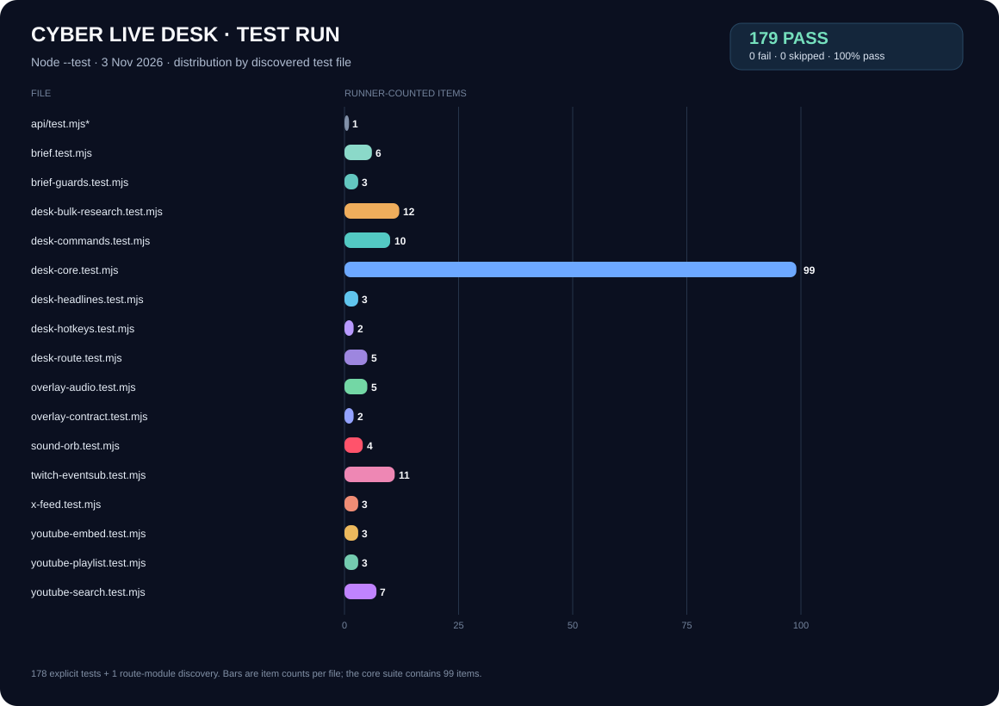

# Cyber Live Desk — Production, Swae & Test Report

**Updated:** 3 November 2026  
**Project:** `cyber-live-desk`  
**Test command:** `node --test`  
**Runtime:** Node.js 24 on Windows

## Executive result

The latest full run passed **179/179 runner-counted items**: 178 explicit test cases plus one Node discovery item for `api/test.mjs` (that route module contains no assertion). There were zero failures, skips, cancellations or todos; duration was **15.39 seconds**. Syntax checks passed for all **43 JavaScript files** under `api/`, `public/` and `tests/`. The browser/server command parser files are byte-identical, and `git diff --check` is clean.

The queue-first CRID YouTube voice-search implementation is commit `6e08900` on `main`. Vercel marked its Production deployment **Ready**. The stable public URL remains [https://cyber-live-desk.vercel.app/desk](https://cyber-live-desk.vercel.app/desk). Vercel currently lists `YOUTUBE_API_KEY` as a Production Secret variable; its value was not read, copied into source, or included in this report. A fresh Production build is required for Vercel Functions to consume a variable added after an earlier deployment; the follow-up report push is used to trigger and verify that build.

## Test distribution

| Test file | Runner-counted items | Coverage |
|---|---:|---|
| `api/test.mjs`* | 1 | Node file-load discovery; no assertion in this route module |
| `tests/brief.test.mjs` | 6 | Freshness parsing, Gemini grounding metadata, private briefs, citations and sources |
| `tests/brief-guards.test.mjs` | 3 | X opt-in, actual Search grounding and focused deeper research |
| `tests/desk-bulk-research.test.mjs` | 12 | Research approvals, ingestion, capacity and source handling |
| `tests/desk-commands.test.mjs` | 10 | `crid` grammar, old-prefix rejection, parser parity, polls and music phrases |
| `tests/desk-core.test.mjs` | 99 | Desk state/actions, audio/mute, privacy projection, music queue/search IDs and Gemini fallback |
| `tests/desk-headlines.test.mjs` | 3 | 12-hour filtering, safe RSS items, cache and Vercel handler contract |
| `tests/desk-hotkeys.test.mjs` | 2 | Explicit shortcut mapping and safeguards |
| `tests/desk-route.test.mjs` | 5 | Public GET/HEAD, private gates, queue-first voice search and missing-key error |
| `tests/overlay-audio.test.mjs` | 5 | Audio synchronization, mute/source cleanup, end state and autoplay rejection |
| `tests/overlay-contract.test.mjs` | 2 | Alive layout activation and official embed usage |
| `tests/sound-orb.test.mjs` | 4 | Compact/active state, mute/volume, buffering/end and listener cleanup |
| `tests/twitch-eventsub.test.mjs` | 11 | Signature, authorization, deduplication and `crid` command path |
| `tests/x-feed.test.mjs` | 3 | Official X v2 endpoint, bounded parameters and validation |
| `tests/youtube-embed.test.mjs` | 3 | Validated IDs and official privacy-enhanced embed URLs |
| `tests/youtube-playlist.test.mjs` | 3 | Official playlist URLs and unsafe-source rejection |
| `tests/youtube-search.test.mjs` | 7 | YouTube Data API request construction, input validation and result normalization |
| **Total reported by Node** | **179** | **178 explicit tests + 1 route-module discovery** |

## Production verification

| Check | Result | Evidence |
|---|---|---|
| Vercel Production build | **Ready** | App code commit `6e08900`; follow-up build is required to load the subsequently added `YOUTUBE_API_KEY`. |
| Public Swae URL | **PASS** | `GET /desk` and `HEAD /desk` returned HTTP 200; HEAD body was empty. |
| Operator page | **PASS** | `/control` returned HTTP 200. |
| Overlay/controller assets | **PASS** | Overlay JS, controller JS, CRID bot and YouTube embed helper returned HTTP 200. |
| Automatic headlines | **PASS** | `/api/desk-headlines` returned HTTP 200 with 6 dated Nigeria-feed headline objects; no headline text was copied to verification logs. |
| Public state | **PASS** | `/api/desk/state?since=-1` returned HTTP 200; no track was active in that check. Unit tests enforce a safe current-track projection. |
| Operator API gate | **PASS** | `/api/desk/cards` and `/api/desk/voice` returned the expected HTTP 401 without an operator token. |
| Live layout and CRID mascot | **PASS** | Root class includes `layout-alive`. CRID is a 60×63 px `DIV`, `aria-hidden=true`, `tabIndex=-1`, `pointer-events:none`, with no button ancestor. |
| Swae device capture | **NOT TESTED ON THE PHONE** | The server-side GET/HEAD check is fixed; the saved Browser Widget still needs an on-device reload/check. |
| On-air YouTube audio | **NOT VERIFIED** | The official embed is supported, but Swae may not route iframe audio into the broadcast. Use a separate visible official player layer if needed. |

## Overlay integration: HTML input and runtime

The overlay remains the project's JavaScript-rendered page: `/desk` serves a small HTML shell that loads `public/desk-assets/overlay.js`. The supplied `overlay-alive.html` and the downloaded overlay/theme/controller/bot files were ported into that existing runtime; they were not installed as a second disconnected page. This keeps the public-state projection, CRID audio synchronization, RSS ticker, Swae detection and controller compatible.

The default `alive` layout is active. The compact identity capsule combines the non-interactive CRID mascot, now-playing details when a track is active, and the lower-third headline/source/age display. The red/black/blue-sheen identity element is decorative only; it does not act as a button and cannot be tapped to start music. Controls live in `/control` and use authenticated operator actions.

## CRID music and YouTube behavior

- `crid music play` starts the current/queue-head track; if there is no current or queued track and the command has no song phrase, it selects the supplied default YE video, `MAMA'S FAVORITE` (`8jDVdq70zUI`). It does **not** autoplay merely because `/desk` was opened.
- `crid music play <song or artist>` first selects one unique queued/current match. If none matches, the authenticated voice route searches the official YouTube Data API, takes one normalized embeddable result, validates its 11-character ID, stores it as the current queued track, and updates public now-playing state.
- YouTube lookup is server-side and requires `YOUTUBE_API_KEY` in Vercel Production. The browser never receives the key. If the variable is absent, the voice route reports a clear configuration error instead of guessing a video. Multiple ambiguous queue matches are refused rather than searched.
- Manual Music Desk search uses the same official API helper; queued YouTube search results now preserve their video ID. The overlay uses the official privacy-enhanced YouTube embed, not audio extraction or hidden-page scraping.
- `crid music pause`, `crid music next` and `crid music stop` remain authenticated voice actions. Twitch chat/EventSub does not gain these voice-only music permissions.

The player was not actively playing during the live layout probe, and Swae phone-side iframe playback/audio routing has not been tested. A YouTube video being visible in a browser widget does not guarantee its audio is mixed into the broadcast.

## News, research and privacy

The compact public lower-third RSS ticker is automatic while the overlay is open. It uses Nigeria-region Google News RSS, excludes undated, unsafe, future-dated and over-12-hour items, and displays source/age. It is **RSS display, not Gemini verification**. If the upstream feed cannot supply fresh headlines, the ticker reports unavailability rather than silently reusing stale content.

The source-linked Gemini research brief remains operator-only and on-demand in `/control`. It uses Google Search grounding and freshness/corroboration context; it is not sent to Swae chat or the public overlay. The public state contains only safe on-air metadata and never the music queue, stream/audio URLs, operator token or volume/mute controls.

## Changed areas

The voice-search follow-up changed `api/desk.mjs`, `api/_desk-core.mjs`, both parser copies, controller voice help and the desk-core/route tests. The merged overlay work also includes the alive layout/theme, self-hosted fonts, compact CRID mascot, official YouTube embed helper, Swae PiP URL and regression tests. Temporary `.work/`, `.manus/` and the separate untracked `public/crid-audio.html` helper are not included in the production code commit.

## Operator steps

1. In Swae, use [https://cyber-live-desk.vercel.app/desk](https://cyber-live-desk.vercel.app/desk) as the landscape Browser Widget/Web Page URL and reload the saved widget once so it retries the fixed public GET/HEAD route.
2. Keep `/desk` open for the automatic, dated RSS lower third. The headlines are not Gemini-verified.
3. Use [https://cyber-live-desk.vercel.app/control](https://cyber-live-desk.vercel.app/control) for private research and controls. Keep the operator token private.
4. For music, say `crid music play` to start the queued track/default, or `crid music play <song or artist>` to try the queue then YouTube search. The API key belongs only in Vercel's server-side Production environment variable.
5. Check on the phone whether Swae displays the iframe/video and whether its audio is actually included in the broadcast; use the separate official player layer if the widget does not route audio.

*Accounting note:* Node discovers `api/test.mjs` because of its filename. The 179 total is reported exactly as Node reports it; it is not 179 assertion-bearing test cases.
