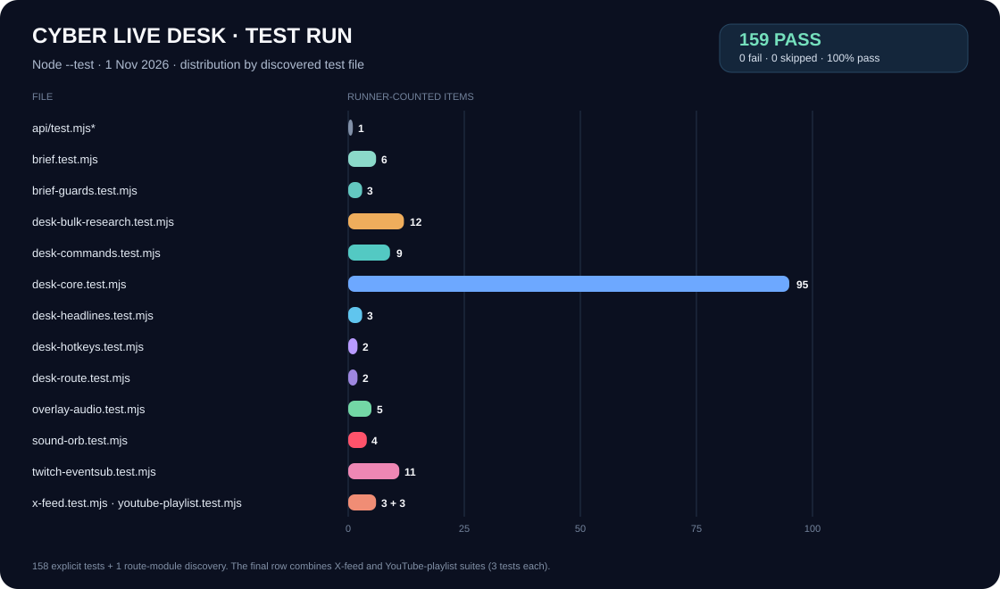

# Cyber Live Desk — Test, Swae Integration & Change Report

**Updated:** 1 November 2026
**Project:** `cyber-live-desk`
**Test command:** `node --test` (`npm test` invokes the same command)
**Runtime:** Node.js 24 on Windows

## Executive result

The latest full run reported **153 passed, 0 failed, 0 cancelled, 0 skipped, and 0 todo** in **15.11 seconds**. That is a 100% pass rate among runner-counted items. The total consists of **152 explicit `test()` cases plus one file-level discovery for `api/test.mjs`**. That API route module contains no test assertion; Node counts it as one passing discovered file. The distinction prevents overstating the result as 153 assertions.

| Test file | Runner-counted items | Coverage |
|---|---:|---|
| `api/test.mjs`* | 1 | Node file-load discovery; no assertion in this route module |
| `tests/brief.test.mjs` | 6 | Freshness parsing, Gemini grounding metadata, private brief composition, citation/source handling |
| `tests/brief-guards.test.mjs` | 3 | X opt-in, required actual Search grounding, focused deeper research |
| `tests/desk-bulk-research.test.mjs` | 12 | Research approvals, ingestion, capacity, held items, source handling |
| `tests/desk-commands.test.mjs` | 9 | Command grammar, parser parity, poll validation, private deeper-angle parsing |
| `tests/desk-core.test.mjs` | 94 | Desk actions, state projection, research queue, CRID audio/mute/play behavior |
| `tests/desk-hotkeys.test.mjs` | 2 | Explicit shortcut mapping and safeguards |
| `tests/overlay-audio.test.mjs` | 5 | Audio synchronization, mute/source cleanup, ended state, autoplay rejection |
| `tests/sound-orb.test.mjs` | 4 | Compact/active state, mute/volume, buffering/end, listener cleanup |
| `tests/twitch-eventsub.test.mjs` | 11 | Signature, authorization, deduplication, command path |
| `tests/x-feed.test.mjs` | 3 | Official X v2 endpoint, parameter bounds, token/input validation |
| `tests/youtube-playlist.test.mjs` | 3 | Official playlist URL generation and unsafe-source rejection |
| **Total reported by Node** | **153** | **152 explicit tests + 1 route-module discovery** |

## Swae-focused behavior

The target is a **landscape 16:9 Twitch stream through Swae**. The `/control` preview now opens in landscape and labels the public `/desk` URL as a Swae Browser Widget/Web Page layer. The public viewer overlay remains separate from the private controller.

The private research brief runs only when the operator requests it from `/control`. It combines dated Google News RSS items with Gemini Google Search grounding, exposes source links and freshness/corroboration limits, separates reporting from inference, and falls back to a “thin” warning when current dated evidence or actual grounded Search results are missing. Topic and angle are editable, including a focused `desk deeper <angle>` command. “Read aloud” uses browser speech synthesis on the controller only. Research is not sent to Swae chat or the viewer overlay.

X is now **off by default** and only queried when the operator enables its one-request checkbox. TikTok is not scraped or represented as a direct feed; the official Creative Center is a manual verification link. Push-to-talk listens on the controller device only after pressing the button; it does not ingest Swae’s broadcast audio or listen continuously. For an on-phone stream, use a separate controller device or type the research topic.

The Music Desk accepts a public YouTube/YouTube Music playlist URL and creates a standard official, visible playlist-player URL for a Swae web-page layer. The helper rejects non-YouTube, non-HTTPS, credentialed, unusual-port, and malformed URLs. It does not scrape YouTube or extract audio, and it does not request autoplay. Keep the YouTube player visible and interactive, privately test Swae capture, and stream only music you have rights to broadcast.

The public overlay now includes a mid-left decorative orb: a red core inside a mostly black shell with a faint blue-black sheen. It expands and pulses only while CRID audio is actually playing, then contracts when muted, buffering, ended, or stopped. It follows the audio player's events, not microphone input, and does not claim to measure waveform amplitude.

### Cost and access limits

Google News RSS is used as a public dated source. **Gemini Google Search grounding is not guaranteed to be free:** Google requires a paid-tier project for grounding; included quota may apply, and excess usage can be billed. The controller discloses this before use. X access may also require a configured API credential and may incur provider cost, which is why X is opt-in per request. There is no honest unlimited-free guarantee for the grounded workflow.

## Validation

| Check | Result | Notes |
|---|---|---|
| Node test runner | **PASS** | 153 pass, 0 fail; output retained in `.work/test-output.txt` |
| Changed-module syntax | **PASS** | `node --check` passed on the changed API, controller, parser, helper, and test modules |
| Diff whitespace | **PASS** | `git diff --check` reported no errors after report cleanup |
| Swae app / iPhone runtime | **NOT RUN** | Browser-layer capture, layout, and real on-device voice behavior still need a private Swae test |
| YouTube playback / broadcast rights | **NOT VERIFIED** | The project only generates the official player link; it does not grant music rights or guarantee Swae audio capture |
| Current follow-up deployment | **PENDING PUSH** | This feature branch is being pushed; Vercel should create its normal Git-triggered preview deployment |

## Current source changes

The current working delta contains **9 modified tracked source files and 8 new source/test files**, plus the three report/chart files. Local `.work` and `.manus` artifacts are excluded from the Git handoff.

| File | Purpose |
|---|---|
| `api/_brief.mjs` | Private on-demand research, dated-source filtering, Gemini Search grounding, citations, freshness guard, concurrency/cooldown, and optional one-shot X snapshot |
| `api/desk.mjs` | Authenticated private brief route and controller-state response wiring |
| `api/x-feed.mjs` | Official X API v2 trend host/schema with bounded parameters |
| `api/_commands.mjs` | Local research/deeper command grammar and display labels; private verbs have no Twitch action mapping |
| `api/_twitch-core.mjs` | Rejects non-actionable private research commands before Twitch dispatch |
| `public/desk-assets/_commands.mjs` | Browser parser parity for the focused deeper command |
| `public/desk-assets/desk-commands.js` | Exposes the parser to the local controller |
| `public/desk-assets/control.js` | Private research/focus/X controls, one-shot local voice/read-aloud, Swae/Twitch landscape preview, and visible YouTube playlist workflow |
| `public/desk-assets/overlay.js` | Mid-left animated red/black orb tied to actual CRID playback, with reduced-motion support |
| `public/desk-assets/sound-orb.js` | Testable audio-event to compact/active orb state synchronizer |
| `public/desk-assets/youtube-playlist.mjs` | Allowlisted HTTPS playlist-to-official-player URL helper |
| `tests/desk-commands.test.mjs` | Command parity and deeper-angle regression coverage |
| `tests/brief.test.mjs` | Research-service integration tests |
| `tests/brief-guards.test.mjs` | X opt-in, Search-grounding, and deeper-focus safeguards |
| `tests/x-feed.test.mjs` | Official X API contract and validation tests |
| `tests/youtube-playlist.test.mjs` | Playlist URL and rejection tests |
| `tests/sound-orb.test.mjs` | Regression tests for playback, mute, buffering/end, and cleanup |

Earlier overlay/audio and keyboard fixes remain in the branch and are covered by their tests; they are not part of the current working-tree delta.

## Operator flow

1. In `/control`, enter a topic and optionally an angle, then run research once. Say **“desk research [topic]”** only while push-to-talk is active; this uses the controller device’s microphone, not Swae’s stream audio.
2. Enter or say **“desk deeper [angle]”** to expand one step, or use refresh. Review the date window, sources, grounded links, warnings, and counterpoint before using any claim.
3. Use **“desk read”** to read a sufficiently current, source-linked brief privately on the controller; **“desk quiet”** stops it.
4. For the public Swae landscape Twitch scene, copy the `/desk` URL and add it as a Browser Widget/Web Page layer. For a playlist, use the YouTube section in Music Desk, copy the generated official player URL, and add that URL as its own visible web-page layer.

*Accounting note:* Node currently discovers `api/test.mjs` because of its filename. Renaming that API route or narrowing the test script to the explicit `tests` directory would make future pass totals correspond only to assertion-bearing files.
